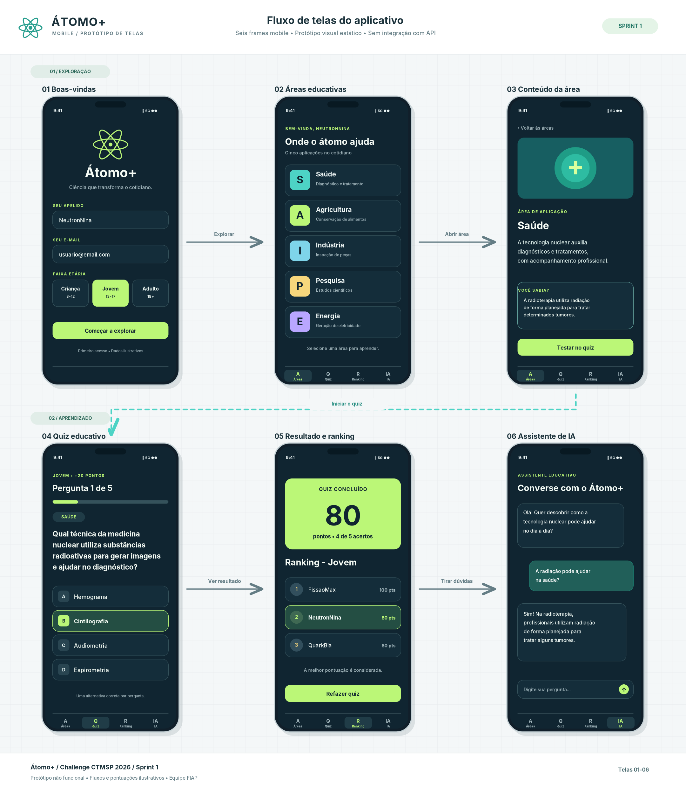

# Átomo+ - Challenge CTMSP 2026 | Sprint 1

**Disciplina:** Mobile Application Development  
**Instituição:** FIAP - Análise e Desenvolvimento de Sistemas  
**Empresa parceira:** Marinha do Brasil - CTMSP  
**Tecnologia:** Dart 3.x (Console)

## Integrantes

| Integrante | RM |
|---|---|
| Gustavo de Jesus | RM567926 |
| Gustavo Siciliano | RM568419 |
| Samuel Keniti | RM567614 |
| Manuel Pedro | RM567458 |
| Vinicius Morrone | RM566884 |

## Sobre o projeto

O **Átomo+** é uma plataforma educativa desenvolvida para o Challenge CTMSP 2026, em parceria com a Marinha do Brasil.

Seu objetivo é aproximar a sociedade da tecnologia nuclear, demonstrando suas aplicações e benefícios em cinco áreas:

- Saúde
- Agricultura
- Indústria
- Pesquisa científica
- Energia

A proposta busca combater a desinformação sobre a tecnologia nuclear por meio de conteúdos educativos e atividades interativas.

Nesta primeira Sprint, foi desenvolvida uma prova de conceito utilizando **Dart em console**, conforme orientação do professor responsável pela turma.

A versão atual demonstra a experiência educativa por meio de menus interativos, conteúdos informativos, quiz e ranking.

Além da aplicação em console, o grupo desenvolveu um **protótipo visual não funcional**, representando a interface mobile planejada para o Átomo+. O protótipo apresenta as principais telas e o fluxo de navegação previsto para a evolução do aplicativo.

## Público-alvo

A aplicação contempla três categorias:

| Categoria | Faixa etária | Pontos por acerto |
|---|---|---|
| CRIANCA | 8 a 12 anos | 10 |
| JOVEM | 13 a 17 anos | 20 |
| ADULTO | 18 anos ou mais | 30 |

Cada categoria possui perguntas adaptadas ao público correspondente.

## Funcionalidades implementadas

### 1. Identificação do usuário

- Entrada de nickname.
- Validação de 3 a 20 caracteres.
- Seleção da categoria do participante.
- Tratamento de entradas inválidas.

### 2. Exploração educativa

O usuário pode explorar as cinco áreas da tecnologia nuclear.

Cada área apresenta:

- Nome e descrição.
- Informações educativas.
- Curiosidades relacionadas ao tema.

### 3. Quiz interativo

- 15 perguntas cadastradas.
- 5 perguntas para cada categoria.
- 4 alternativas por pergunta.
- Apenas uma alternativa correta.
- Validação das respostas.
- Explicação educativa após cada pergunta.

### 4. Sistema de pontuação

A pontuação varia conforme a categoria:

- CRIANCA: 10 pontos por acerto.
- JOVEM: 20 pontos por acerto.
- ADULTO: 30 pontos por acerto.

Ao finalizar o quiz, são apresentados:

- Quantidade de acertos.
- Quantidade de erros.
- Percentual de aproveitamento.
- Tempo de realização.
- Pontuação total.

### 5. Histórico e ranking

- Registro das tentativas concluídas.
- Classificação por categoria.
- Armazenamento da melhor pontuação de cada participante.
- Critério de desempate considerando o tempo.

**Observação:** os dados do histórico e do ranking são mantidos em memória durante a execução do programa, sem persistência em banco de dados.

## Protótipo visual do aplicativo

Além da implementação em Dart Console, foi desenvolvido um **protótipo visual não funcional do Átomo+**, com o objetivo de representar a experiência do usuário em uma futura aplicação mobile.

O protótipo foi elaborado com aparência de aplicativo para dispositivos móveis, seguindo conceitos de organização visual e navegação semelhantes aos utilizados em ferramentas de prototipação, como o Figma.

O material apresenta uma proposta de interface baseada nas funcionalidades e regras de negócio da plataforma educativa.

### Telas do protótipo

O protótipo contempla seis telas principais:

1. **Identificação do usuário:** apresentação inicial e seleção do perfil do participante.
2. **Áreas educativas:** navegação pelas áreas de aplicação da tecnologia nuclear.
3. **Conteúdo educativo:** apresentação de informações e curiosidades sobre os temas escolhidos.
4. **Quiz interativo:** representação visual das perguntas e alternativas.
5. **Resultados e ranking:** apresentação da pontuação e do desempenho do participante.
6. **Assistente de inteligência artificial:** representação conceitual de um recurso planejado para futuras versões.

### Visualização do protótipo

A imagem abaixo apresenta a proposta visual das telas do Átomo+.



**Arquivo do protótipo:** [Visualizar protótipo em SVG](doc/Prototipo.png)

O arquivo SVG permite visualizar o layout das telas com qualidade vetorial, preservando os elementos gráficos e a organização visual do projeto.

### Apresentação do protótipo

O grupo também disponibiliza uma versão em PowerPoint, utilizada para apresentar as telas e o fluxo visual do aplicativo.

[Visualizar apresentação do protótipo em PowerPoint](Atomo_Prototipo_Estilo_Figma.pptx)

### Objetivo da prototipação

A elaboração do protótipo busca:

- Demonstrar visualmente a proposta do Átomo+.
- Representar a navegação entre as principais telas.
- Organizar as funcionalidades educativas em uma interface mobile.
- Facilitar a compreensão da experiência planejada para o usuário.
- Servir como referência para o desenvolvimento de uma interface gráfica nas próximas Sprints.

**Importante:** o protótipo é uma representação visual da aplicação e não substitui o sistema desenvolvido em Dart Console.

As funcionalidades de identificação, exploração educativa, quiz, pontuação e ranking estão implementadas na aplicação em console.

A interface gráfica e o assistente de inteligência artificial apresentados no protótipo fazem parte da proposta de evolução da plataforma e não são considerados funcionalidades implementadas nesta Sprint.

## Tecnologias utilizadas

### Aplicação em console

- Dart 3.x
- Programação Orientada a Objetos (POO)
- Estruturas de dados e coleções
- Validação de entradas
- Tratamento de erros
- Testes automatizados com Dart

### Prototipação visual

- Protótipo de interface mobile
- Formato SVG para visualização das telas
- PowerPoint para apresentação visual
- Organização de telas e fluxo de navegação
- Representação visual de funcionalidades futuras

## Estrutura do projeto

```text
bin/
  main.dart

lib/
  atomo_mais.dart
  src/
    console/
    data/
    historico/
    models/
    quiz/

test/
  console_test.dart
  dados_mock_test.dart
  historico_test.dart
  modelos_test.dart
  quiz_test.dart
  suporte.dart
  todos_test.dart

prototipo.svg
Atomo_Prototipo_Estilo_Figma.pptx

pubspec.yaml
pubspec.lock
.gitignore
README.md
```

Os arquivos `prototipo.svg` e `Atomo_Prototipo_Estilo_Figma.pptx` representam os materiais visuais complementares à aplicação Dart.

## Como executar

### Pré-requisitos

Ter o Dart SDK 3.x instalado e configurado no computador.

Documentação oficial:

https://dart.dev/get-dart

### Executar a aplicação

No terminal, acesse a pasta raiz do projeto e execute:

```bash
dart run bin/main.dart
```

### Utilização

1. Informe um nickname válido.
2. Escolha sua categoria.
3. Navegue pelo menu principal.
4. Explore as áreas educativas.
5. Realize o quiz.
6. Consulte seus resultados e o ranking.

O menu principal disponibiliza as opções:

- 1 - Explorar áreas.
- 2 - Iniciar quiz.
- 3 - Ranking.
- 4 - Encerrar.

### Visualizar o protótipo

Para visualizar a proposta de interface mobile, abra o arquivo `prototipo.svg` em um navegador ou visualizador compatível com SVG.

O arquivo também pode ser importado para ferramentas de edição vetorial, incluindo o Figma, para consulta e adaptação do layout.

A apresentação em PowerPoint pode ser aberta para visualizar as telas e apresentar a proposta de navegação.

**Observação:** não é necessário executar a aplicação Dart para visualizar o protótipo, pois os materiais são independentes.

## Testes e qualidade

O projeto possui testes automatizados para verificar o comportamento das principais funcionalidades.

Para executar a análise estática:

```bash
dart analyze
```

Para executar os testes:

```bash
dart run test/todos_test.dart
```

Os testes abrangem:

- Modelos de dados.
- Perguntas educativas.
- Regras do quiz.
- Histórico de tentativas.
- Sistema de pontuação.
- Ranking.
- Comportamento da aplicação em console.

**Observação:** os comandos devem ser executados no ambiente utilizado pela equipe para confirmar o funcionamento da versão entregue.

O protótipo visual não participa dos testes automatizados, pois não implementa as regras de negócio nem realiza comunicação com serviços externos.

## Escopo da Sprint 1

Esta entrega apresenta a experiência educativa inicial do Átomo+ utilizando Dart em console, acompanhada de um protótipo visual do aplicativo mobile.

### Funcionalidades implementadas

- Identificação de participantes.
- Conteúdos educativos.
- Perfis por faixa etária.
- Quiz interativo.
- Sistema de pontuação.
- Histórico e ranking em memória.

### Material de prototipação

- Representação visual das telas do aplicativo.
- Fluxo de navegação proposto.
- Organização visual das funcionalidades educativas.
- Arquivo SVG do protótipo.
- Apresentação em PowerPoint.

### Evoluções previstas

Para etapas futuras, a proposta geral contempla:

- Interface gráfica para site e aplicativo.
- Assistente de inteligência artificial funcional.
- Integração com APIs.
- Integração com banco de dados.
- Persistência dos resultados.
- Sincronização entre os diferentes componentes da plataforma.

Essas funcionalidades futuras não são apresentadas como implementadas nesta Sprint.

## Vídeo demonstrativo

O vídeo apresenta a demonstração do projeto Átomo+ em Dart Console, incluindo as funcionalidades desenvolvidas para a primeira Sprint.

**Vídeo da Sprint 1:**

[Assistir à demonstração do Átomo+ no YouTube](https://www.youtube.com/watch?v=pjzzZ6KsuLo)

A demonstração contempla:

- Inicialização do programa.
- Identificação do participante.
- Seleção de categoria.
- Exploração das áreas educativas.
- Execução do quiz interativo.
- Apresentação dos resultados.
- Funcionamento do ranking.

O protótipo visual complementa essa demonstração, apresentando uma proposta de como as funcionalidades poderão ser organizadas em uma futura interface mobile.

## Considerações finais

O Átomo+ foi idealizado para apresentar a tecnologia nuclear de forma educativa, acessível e interativa.

A implementação em Dart Console demonstra as principais regras de negócio e funcionalidades da experiência proposta, constituindo uma base para a evolução da plataforma nas próximas Sprints do Challenge CTMSP 2026.

Como complemento, o desenvolvimento do protótipo visual permite apresentar a organização planejada das telas e o fluxo de navegação de uma futura aplicação mobile.

A combinação entre implementação das regras de negócio e prototipação visual contribui para uma apresentação mais completa da solução, diferenciando as funcionalidades já desenvolvidas daquelas previstas para etapas posteriores.

O projeto busca incentivar a aprendizagem, estimular a curiosidade científica e contribuir para uma compreensão mais ampla das aplicações pacíficas da tecnologia nuclear.